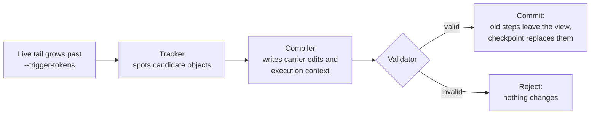

<div align="center">

# carrycode

### CarryOn context for coding agents: carry the progress, not the whole history.

**An open implementation of [*Pack Light, CarryOn*](https://arxiv.org/abs/2610.18784) (arXiv:2610.18784), wrapped as a coding agent you can run in your own repository.**

[](https://arxiv.org/abs/2610.18784)
[](pyproject.toml)
[](https://github.com/SWE-agent/mini-swe-agent)
[](https://docs.litellm.ai/docs/providers)
[](LICENSE)

[Quick start](#quick-start) · [How it works](#how-it-works) · [Choosing models](#choosing-models) · [Options](#options) · [Paper results](#results-reported-in-the-paper) · [Troubleshooting](#troubleshooting) · [For researchers](#for-researchers)

<code>uv tool install git+https://github.com/xuan-tu-ai/carrycode</code>

</div>

---

A coding agent that works for a long time keeps re-reading its own history: every command, every file
it opened, every failed attempt. Most of that progress already lives somewhere else, in the edited files,
the test results and the things the agent has learned. CarryOn replaces old history with a compact,
structured checkpoint of that progress and keeps only the recent steps verbatim.

carrycode puts the CarryOn runtime under a small, transparent agent
([mini-swe-agent](https://github.com/SWE-agent/mini-swe-agent)) and gives you one command to run it on
any repository, with any model that [LiteLLM](https://docs.litellm.ai/docs/providers) supports.

> [!NOTE]
> carrycode is an independent reimplementation built from the paper alone. It is not affiliated with the
> paper's authors, who have not released their code.

## Quick start

### 1. Install

You need Python 3.11+ and [uv](https://docs.astral.sh/uv/getting-started/installation/). Linux and macOS
are supported; on Windows, use WSL.

```bash
uv tool install git+https://github.com/xuan-tu-ai/carrycode
carrycode --help
```

### 2. Add an API key

Export the key for your provider (add the line to `~/.bashrc` or `~/.zshrc` to keep it):

```bash
export ANTHROPIC_API_KEY=sk-ant-...     # or OPENAI_API_KEY, GEMINI_API_KEY, DEEPSEEK_API_KEY, ...
```

### 3. Run it in your repository

```bash
cd path/to/your/repo
carrycode run -m anthropic/claude-sonnet-4-6 "Fix the failing test in tests/test_parser.py"
```

Leave out the task to type it interactively. The agent proposes one shell command at a time; you approve
each one (see [Working with the agent](#working-with-the-agent)).

> [!TIP]
> Commit or stash your work first. The agent edits files in place, and `git diff` then shows exactly
> what it changed.

### Update or uninstall

```bash
uv tool upgrade carrycode
uv tool uninstall carrycode
```

## Working with the agent

carrycode uses mini-swe-agent's terminal loop. By default it runs in **confirm** mode:

| You type | Effect |
| --- | --- |
| <kbd>Enter</kbd> | Run the proposed command |
| any text | Reject the command and send your text to the agent as feedback |
| `/y` | Switch to **yolo** mode: run commands without asking |
| `/c` | Switch back to **confirm** mode |
| `/u` | Switch to **human** mode: you type the commands yourself |
| `/h` | Show help |
| <kbd>Ctrl</kbd>+<kbd>C</kbd> | Interrupt the agent and give it a comment |

When the agent says it is done, type a follow-up task or press <kbd>Enter</kbd> to quit. Each time the
runtime folds history into the checkpoint, you will see a line like:

```text
carryon: fold 1 committed; the live tail now starts at message 14.
```

At the end, carrycode prints the exit status, steps, cost and number of folds, and saves the full
trajectory (every message, plus the carriers and fold events) to the file given by `--output`.

## How it works

CarryOn replaces the old part of the conversation with a **context view** of three parts:

- **Continuation carriers**: reusable task objects, such as an edited file, a finding backed by
  `file:line` evidence, or the state of the environment, each with the conditions under which it can be
  reused.
- **Execution context**: the goal, constraints and open work that no carrier captures.
- **Live tail**: the raw steps since the last fold.

When the live tail grows past a token budget (`--trigger-tokens`), the runtime **folds**:



The Tracker and the Compiler are two extra LLM calls made with the runtime model (`--runtime-model`).
A fold is all or nothing: if any step fails, the carriers, the execution context and the live tail stay
exactly as they were. The full interaction log is never rewritten; only the view sent to the model
changes, so the saved trajectory is complete.

### When does it make a difference?

CarryOn helps on **long** sessions, where the history would otherwise grow to hundreds of thousands of
tokens. By default the first fold happens once the live tail reaches about 24,000 tokens. A short task
never reaches that point, and carrycode then behaves exactly like plain mini-swe-agent. Lower
`--trigger-tokens` to fold earlier.

## Choosing models

Pass any LiteLLM model id with `-m`. The agent model must support **tool calling**; the runtime model
must return **JSON**. A few examples:

| Provider | Key variable | Example `-m` |
| --- | --- | --- |
| Anthropic | `ANTHROPIC_API_KEY` | `anthropic/claude-sonnet-4-6`, `anthropic/claude-opus-4-6` |
| OpenAI | `OPENAI_API_KEY` | `openai/gpt-5` |
| Google Gemini | `GEMINI_API_KEY` | `gemini/gemini-2.5-pro` |
| DeepSeek | `DEEPSEEK_API_KEY` | `deepseek/deepseek-chat` |

See the [LiteLLM provider list](https://docs.litellm.ai/docs/providers) for the rest.

**Save money with a cheaper runtime model.** The Tracker and Compiler only read and summarise, so a smaller
model usually does:

```bash
carrycode run -m anthropic/claude-opus-4-6 --runtime-model anthropic/claude-sonnet-4-6 "..."
```

**OpenAI-compatible endpoints and custom settings.** Put the models in a YAML file and pass `--models`.
The files in [`configs/models/`](configs/models/) are working examples (an OpenAI-compatible gateway with
its own key variable, extra `model_kwargs`, prices for models LiteLLM does not know):

```yaml
# my-models.yaml
api_key_env: MY_GATEWAY_KEY          # copied to OPENAI_API_KEY at startup
host:
  model_name: "openai/my-model"
  model_kwargs: { api_base: "https://gateway.example.com/v1", drop_params: true }
runtime:
  model_name: "openai/my-model"
  model_kwargs: { api_base: "https://gateway.example.com/v1", drop_params: true }
```

```bash
carrycode run --models my-models.yaml "..."
```

## Options

```text
carrycode run [TASK] [OPTIONS]
```

| Option | Default | Meaning |
| --- | --- | --- |
| `-m, --model` | (required) | LiteLLM model id for the agent |
| `--runtime-model` | same as `--model` | Model for the Tracker and the Compiler |
| `--models FILE` | | Models YAML; replaces `--model` and `--runtime-model` |
| `--cwd DIR` | `.` | Repository to work in |
| `-y, --yolo` | off | Run commands without asking |
| `-l, --cost-limit` | `3` | Stop after this many dollars; `0` disables the limit |
| `--step-limit` | `0` (none) | Stop after this many model calls |
| `--trigger-tokens` | `24000` | Fold when the live tail reaches this many tokens |
| `--keep-recent-tokens` | `8000` | Raw recent history kept after a fold |
| `-o, --output` | `<mini-swe-agent config dir>/last_carrycode_run.traj.json` | Where to save the trajectory |
| `--exit-immediately` | off | Quit when the agent finishes instead of asking for a new task |

When a limit is reached in an interactive terminal, you are asked for new limits instead of the run
stopping.

## Results reported in the paper

These numbers come from the paper (Lu, McAuley, Zhang, 2026), measured with Claude Opus 4.7 as the agent.
carrycode has not been benchmarked against them.

| Benchmark | Metric | Baseline | With CarryOn |
| --- | --- | --- | --- |
| OSWorld 2.0 | Partial score | 43.9% | **49.7%** |
| OSWorld 2.0 | Binary score | 15.7% | **19.4%** |
| OSWorld 2.0 | Total tokens per task | 40.1M | **19.3M** (−51.9%) |
| OSWorld 2.0 | Cost per task | $36.8 | **$23.6** (−35.9%) |
| BrowseComp-Plus | Accuracy | 49.0% | **56.0%** |
| BrowseComp-Plus | Total tokens per task | 1.56M | **1.20M** (−22.9%) |

The gains come from long tasks: in the paper, OSWorld runs last hundreds of turns, and the mean input
context with CarryOn levels off near 65K tokens instead of growing with every turn.

## What carrycode adds

- **Coding carriers.** Carriers are edited files, findings backed by `file:line` evidence, and
  environment state (installed packages, the current branch), instead of the paper's desktop and web
  objects.
- **Partial folds.** `--keep-recent-tokens` keeps the most recent steps verbatim after a fold, so the
  agent does not lose its immediate working context.
- **One-command use.** `carrycode run` works in any repository with any LiteLLM model.
- **Planned: a content-level Grounder.** Checks that re-run recorded tests and inspect `git diff` before
  a carrier is committed. The checks exist in [`src/carrycode/grounder/`](src/carrycode/grounder/) but
  are not yet used inside folds.

## Safety and privacy

- Commands run **on your machine with your permissions**. Keep confirm mode on unless the repository is
  disposable or you run carrycode inside a container or VM.
- Your code and command output are sent to the model provider you choose, as with any coding agent.
- API keys are read from the environment and never written to trajectory files.

## Troubleshooting

<details>
<summary><b>"Missing credentials" or an authentication error</b></summary>

The key variable for your provider is not set in this shell. Run `export ANTHROPIC_API_KEY=...` (or the
variable for your provider) and try again. With `--models`, the file's `api_key_env` names the variable.
</details>

<details>
<summary><b>"Error calculating cost for model ..."</b></summary>

LiteLLM has no price for the model, so the cost limit cannot be enforced. Either add prices with a models
file (`price_registry`, see [`configs/models/litellm_registry.json`](configs/models/litellm_registry.json)),
or skip cost tracking:

```bash
export MSWEA_COST_TRACKING=ignore_errors
```
</details>

<details>
<summary><b>The model replies but never runs a command</b></summary>

The agent model must support tool calling. Pick a model with function or tool calling in LiteLLM's
provider docs.
</details>

<details>
<summary><b>No fold ever happens</b></summary>

That is expected on short tasks: the live tail never reaches `--trigger-tokens` (24,000 by default). Lower
it, for example `--trigger-tokens 8000 --keep-recent-tokens 2000`, to see folds sooner.
</details>

<details>
<summary><b>"Warning: Input is not a terminal"</b></summary>

Harmless. It appears when stdin is not a terminal, for example in scripts. Use `--yolo --exit-immediately`
for unattended runs.
</details>

## For researchers

The repository also contains the evaluation harness used to study CarryOn on SWE-bench.

```bash
git clone https://github.com/xuan-tu-ai/carrycode.git
cd carrycode
uv sync
uv run pytest                     # offline tests: no API keys, no Docker
cp .env.example .env              # add the key named in your models config
uv run python scripts/run_swebench.py --help
```

Benchmark runs need Docker. Each experiment is one YAML file in
[`configs/experiments/`](configs/experiments/), for example the plain baseline, a sliding-window baseline
and CarryOn:

```bash
uv run python scripts/run_swebench.py --experiment configs/experiments/carryon_full.yaml \
  --instances data/m0_instances.txt --workers 2
```

| Path | What is there |
| --- | --- |
| `src/carrycode/` | The runtime: records, registry, view, Tracker, Compiler, Validator, Grounder, agents, CLI |
| `src/carrycode/prompts/` | Tracker and Compiler prompts, written for this project |
| `configs/` | Model and experiment configs |
| `scripts/` | SWE-bench runner, subset selection, result summaries |
| `docs/paper_map.md` | Which paper section each module implements |
| `docs/decisions.md` | Design decisions and measurements, newest first |

## Acknowledgements

- Yuchen Lu, Julian McAuley and Lei Zhang, for the CarryOn paper.
- [mini-swe-agent](https://github.com/SWE-agent/mini-swe-agent), the agent loop carrycode extends.
- [LiteLLM](https://github.com/BerriAI/litellm), for one interface to every model provider.

## Citation

If you use carrycode, please cite the original paper:

```bibtex
@article{lu2026carryon,
  title   = {Pack Light, CarryOn: Building Object-Oriented Context for Long-Horizon Agents},
  author  = {Lu, Yuchen and McAuley, Julian and Zhang, Lei},
  journal = {arXiv preprint arXiv:2610.18784},
  year    = {2026}
}
```

## License

Apache-2.0. See [LICENSE](LICENSE) and [NOTICE](NOTICE).
