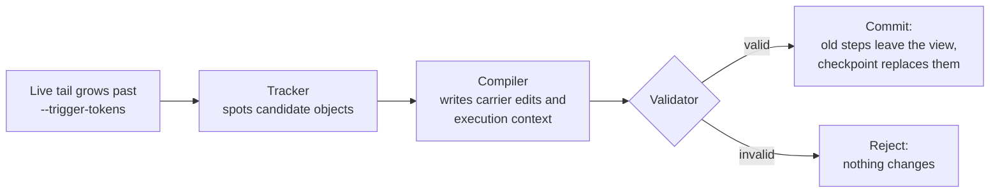

# How it works

CarryOn replaces the old part of the conversation with a **context view** of three parts:

- **Continuation carriers**: reusable task objects, such as an edited file, a finding backed by
  `file:line` evidence, or the state of the environment, each with the conditions under which it can be
  reused.
- **Execution context**: the goal, constraints and open work that no carrier captures.
- **Live tail**: the raw steps since the last fold.

When the live tail grows past a token budget (`--trigger-tokens`), the runtime **folds**:

The Tracker and the Compiler are two extra LLM calls made with the runtime model (`--runtime-model`).
A fold is all or nothing: if any step fails, the carriers, the execution context and the live tail stay
exactly as they were. The full interaction log is never rewritten; only the view sent to the model
changes, so the saved trajectory is complete.

## When does it make a difference?

CarryOn helps on **long** sessions, where the history would otherwise grow to hundreds of thousands of
tokens. By default the first fold happens once the live tail reaches about 24,000 tokens. A short task
never reaches that point, and carrycode then behaves exactly like plain mini-swe-agent. Lower
`--trigger-tokens` to fold earlier.

## What carrycode adds

- **Coding carriers.** Carriers are edited files, findings backed by `file:line` evidence, and
  environment state (installed packages, the current branch), instead of the paper's desktop and web
  objects.
- **Partial folds.** `--keep-recent-tokens` keeps the most recent steps verbatim after a fold, so the
  agent does not lose its immediate working context.
- **One-command use.** `carrycode run` works in any repository with any LiteLLM model.
- **Planned: a content-level Grounder.** Checks that re-run recorded tests and inspect `git diff` before
  a carrier is committed. The checks exist in [`src/carrycode/grounder/`](../src/carrycode/grounder/) but
  are not yet used inside folds.

Which paper section each module implements: [paper_map.md](paper_map.md).
